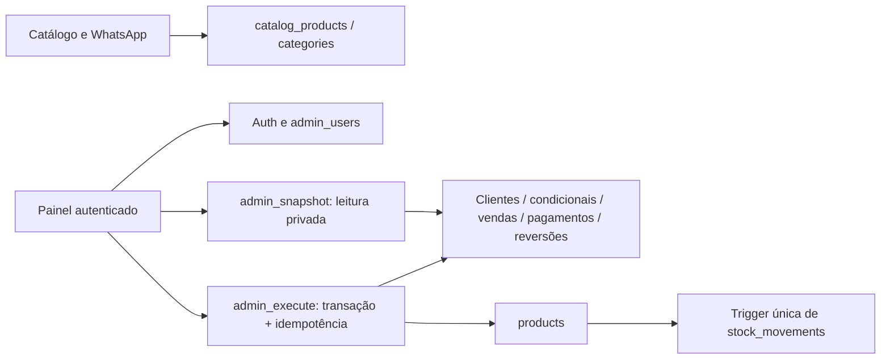

# Arquitetura da missão integral

React 18 + TypeScript continuam sendo a aplicação; Vite empacota, React Router mantém as rotas e Supabase fornece Auth, PostgreSQL e Storage. Não existe backend simulado no produto. Os novos serviços ficam em `src/admin/services.ts`; a vitrine continua nos módulos anteriores, sem qualquer escrita de gestão.

`20260101000000_fundacao.sql` permanece intacta. A migração B `20261028000000_gestao_base.sql` é recuperada em bytes do backup e não reescrita, pois já foi aplicada pelo proprietário num projeto de teste. `20261029000000_operacoes.sql` estende essa estrutura e expõe duas RPCs.

`admin_execute(uuid,text,jsonb)` verifica `auth.uid()` e `is_admin()` em cada chamada, adquire lock transacional global da gestão, verifica chave/operação/payload/autor e executa todos os efeitos na mesma transação. Os produtos também são bloqueados ao consumir disponibilidade. A loja é pequena e possui uma proprietária: serializar as operações é uma escolha deliberada de simplicidade e consistência. Alta concorrência exigiria granularizar locks mantendo ordem determinística.

A API não tem grants de escrita direta nas novas tabelas. RPCs e funções auxiliares têm grants explícitos; funções SECURITY DEFINER possuem search_path vazio e nomes de relações qualificados. `admin_snapshot` verifica admin antes de ler e não é executável por anon. O snapshot carrega os registros de gestão sem paginação, apropriado à base pequena; volume elevado exigirá consultas paginadas e agregações específicas.

Estoque de `products.stock_quantity` significa disponibilidade em loja. Pendência física da condicional é derivada dos itens e eventos; vendas de condicional consomem pendência, sem segunda baixa. O total físico sob controle é disponível + pendente. Retornos de vendas só repõem disponível mediante confirmação física; estornos financeiros ficam em eventos separados.

Cabeçalhos e linhas históricas são imutáveis. Cliente pode ser atualizado/arquivado, com trigger de auditoria; nome da cliente e descrição/nome/categoria/preços dos produtos são fotografados nas novas entregas/vendas. Registros B anteriores às novas colunas não ganham snapshots inventados: o painel identifica nome histórico ausente.

A tela de preparação de entrega/venda usa estado local apenas como formulário; nada é persistido até confirmação da operação transacional. Não há rascunho administrativo persistido. Estados aberto/concluído e quitado/pendente/cancelado são derivados dos eventos e saldos, evitando flags inconsistentes.

## Evolução V4.1

`20261029010000_exclusao_segura_v41.sql` acrescenta consulta administrativa de elegibilidade e os comandos customer_delete/product_delete/customer_archive/product_archive. O corpo V4.0 de admin_execute é renomeado para admin_execute_v40 e perde EXECUTE pela API; o novo wrapper mantém a assinatura original e delega os comandos anteriores. Chamadas recursivas de cancelamento continuam passando pelo wrapper. Não se reescrevem as migrações anteriores.

A identidade de auditoria é separada do cadastro operacional: customer_audit_subjects possui somente UUIDs permanentes e RLS administrativa. A migração copia os IDs existentes para essa tabela e redireciona a FK de customer_audit, sem alterar/apagar as linhas auditadas. A trigger de criação/edição garante a identidade antes de inserir auditoria. A tabela de identidades é imutável; o cadastro só é elegível para exclusão se não houver referências comerciais ou auditoria de alterações.

O helper privado deletion_dependencies verifica o catálogo de FKs, incluindo tabelas futuras, e gera motivos seguros para a interface. admin_deletion_info exige admin e não autoriza exclusão por si só. A operação definitiva adquire o lock de gestão, bloqueia o cadastro e repete as verificações; uma guarda BEFORE DELETE exige o contexto interno da RPC e reconfere vínculos. FKs e locks protegem inserções concorrentes. Falhar a gravação de operation_requests desfaz inclusive o DELETE.

RecordActionDialog é compartilhado entre clientes e produtos: consulta o banco, mostra nome e irreversibilidade, exige confirmação, mantém chave de tentativa em erro e oferece arquivamento quando bloqueado. Arquivamento é atualização restrita ao estado, sem reenviar campos potencialmente antigos de cadastro. Nenhuma chamada ao Storage faz parte desse comando.
